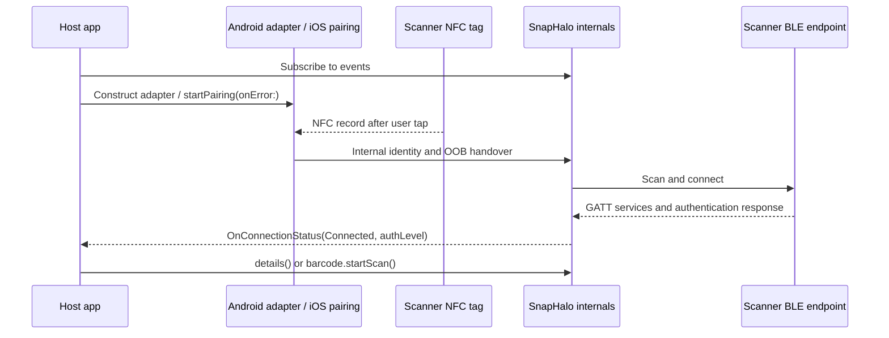
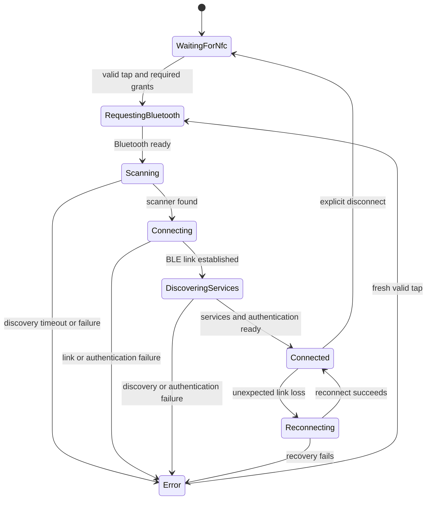

# Pairing and connection: NFC OOB and BLE lifecycle

The public SDK starts from a Snap Halo NFC tap to pair. On Android, create one `SnapHaloAndroid` for a `ComponentActivity` and a `SnapHalo` client. On iOS, call `SnapHalo.startPairing(onError:)` on the main thread. Both routes hand the tag data to the SDK, which discovers the scanner, connects over BLE, and reports typed connection states.

## NFC out-of-band handover

1. Subscribe to `SnapHalo.events` before starting the connection; it has no replay. Swift may use `observeEvents`, retaining and closing its returned `KotlinAutoCloseable`.
2. Android: create `SnapHaloAndroid(activity, snapHalo, onError)` in `onCreate` after `super.onCreate` and before `onStart`. The adapter enables foreground NFC reader mode and handles its launch/new intents automatically. Both the [Kotlin](../Samples/Kotlin/app/src/main/kotlin/com/ipcmobile/snapipc/androidnative/MainActivity.kt) and [React Native](../Samples/ReactNative/android/app/src/main/java/com/ipcmobile/snapipc/reactnative/MainActivity.kt) samples construct it there.
3. iOS: call `startPairing(onError:)` from the app's pairing action, as in [`SnapIPCAppModel.startNfcPairing()`](../Samples/Swift/Sources/SnapIPCAppModel.swift). The SDK presents the NFC sheet and connects after a valid read.
4. Hold the phone at the scanner's pairing point. The SDK reads the identity/OOB carrier, requests Android grants or Bluetooth enablement as needed, scans for the device, and authenticates when the tag contains a complete modern credential.
5. Wait for `SnapHaloEvent.OnConnectionStatus` with `ConnectionState.Connected` before sending commands or querying details. Handle `errorMessage` and the platform pairing callback separately.

A complete credential triggers an internal challenge/response; `Connected` follows successful authentication. An address-only record or legacy URI carries no tap proof and may have restricted commands on newer firmware. The byte layout and key-handling procedure are not supplied as host APIs. Application-layer proof is distinct from OS Bluetooth bonding.

For a cold NFC launch, both Android samples keep launcher and `ipcstar://nfc` VIEW filters on the main Activity and put NDEF filters on a separate Activity alias. The alias uses `@string/snapipc_nfc_dispatch_permission`, supplied by the AAR, to meet API 37 NFC dispatch requirements without restricting normal app launches. Foreground reader mode works without those filters while the Activity is resumed. The [Kotlin manifest](../Samples/Kotlin/app/src/main/AndroidManifest.xml) and [React Native manifest](../Samples/ReactNative/android/app/src/main/AndroidManifest.xml) show the full routing.

## BLE discovery and filtering

The SDK performs discovery internally. The Android reference describes matching a scanner by address service data, or manufacturer data. Use `snapHalo.readRssi()` only to inspect an **already connected** BLE link; it is not a discovery filter. Avoid building a parallel host scan that races the SDK's connection attempt.

Android scanning and initial connection each have a documented 20-second timeout. NFC and Bluetooth must be enabled, and the required runtime grants must be available before the adapter proceeds. The Android adapter reports NFC, permission, and readiness problems through `onError`; transport failures arrive as `OnConnectionStatus(Error, errorMessage)`.

## Connection state machine

The public enum has `WaitingForNfc`, `RequestingBluetooth`, `Scanning`, `Connecting`, `DiscoveringServices`, `Connected`, `Reconnecting`, and `Error`. It has no separate `Disconnected` or `Ready` member; treat `Connected` as the command-ready signal. The SDK negotiates Android MTU and checks the authentication response fits. It does not expose a public MTU setter.

Unexpected loss of an established link invokes SDK reconnection. Explicit disconnect stops that behavior. On Android, call `SnapHaloAndroid.cancelPendingConnection()` on the main thread before awaiting `snapHalo.disconnect()` so a queued NFC tap cannot start a new attempt. Close the adapter with its Activity; close the client with its owning scope. A fresh client is needed after `close()`/`dispose()`.

The React Native Android bridge's `startPairing()` calls `SnapHaloAndroid.requestPermissions()` to retry missing grants. The adapter remains active for the next NFC tap; that button does not select or identify a scanner by itself. The Kotlin sample lets the adapter request missing grants on startup and after a valid tap.

`authLevel` and `OnConnectionStatus.authLevel` expose `Locked`, `Tapped`, and `Operational`. `hardwareSerial` is populated when hardware verification succeeds. An `OnSecurityWarning` reports optional attestation unavailability; host apps cannot supply customer signers or administrator keys through the public API. See [troubleshooting](06-Troubleshooting-and-Error-Codes.md) for recovery actions.
