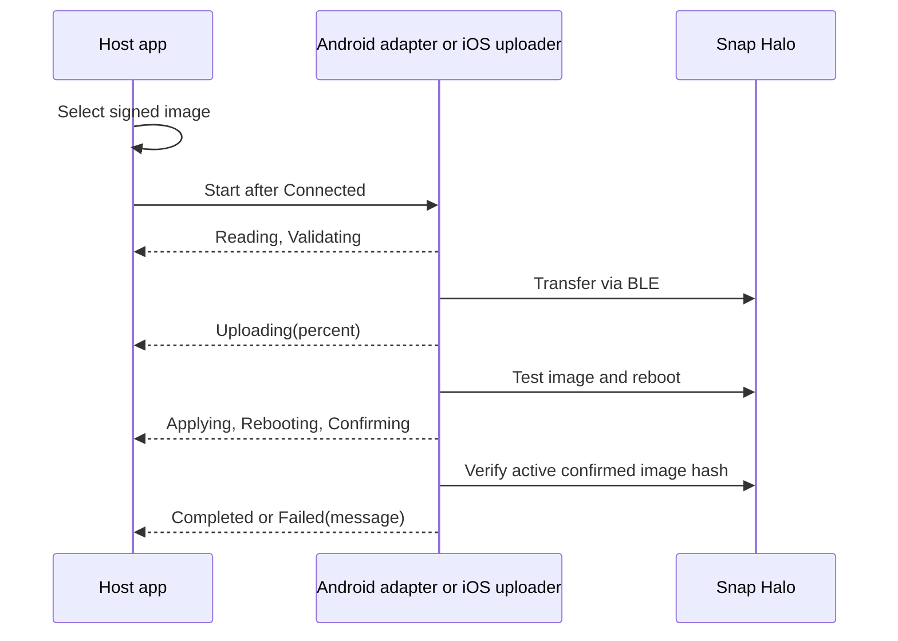

# OTA firmware updates

The Android 1.0.0 AAR exposes `SnapHaloAndroid.uploadFirmware(uri, onStatus)` and `cancelFirmwareUpload()`. The current iOS `SnapIPCSDK.xcframework` exposes `SnapHaloFirmwareUploader` and `SnapHaloFirmwareUploadStatus` directly from the `SnapIPCSDK` Swift module. Both uploaders transfer a selected image through Nordic MCUmgr, then test, reboot, confirm, and verify the active image. iOS apps link the XCFramework with **Embed & Sign**; no separate firmware package is required. The generated Kotlin iOS reference does not list this Swift-only API; its public declaration is in the XCFramework's `SnapIPCSDK.swiftinterface`.

## Update lifecycle



Both uploaders accept an approved, signed firmware `.bin` or a ZIP with a signed image.  `Completed` / `.completed` means the expected image hash was read back as active and confirmed. The public progress status contains a percentage, with no documented `bytesPerSecond` callback.

## Android: execute an update

Obtain the `Uri` through the host's document picker. Keep the `SnapHaloAndroid` adapter alive for the Activity and start only after the scanner reports `ConnectionState.Connected` and required Bluetooth permissions are granted. The callback runs on the main thread. The supplied Kotlin and React Native Android samples display firmware versions but do not include an upload screen; this snippet shows how a host app can add one.

```kotlin
import android.net.Uri
import android.util.Log
import com.ipcmobile.snapipcsdk.android.SnapHaloAndroid
import com.ipcmobile.snapipcsdk.models.FirmwareUploadStatus

class FirmwareUpdateUi(private val adapter: SnapHaloAndroid) {
    fun start(selectedImage: Uri) {
        try {
            adapter.uploadFirmware(selectedImage) { status ->
                when (status) {
                    is FirmwareUploadStatus.Uploading ->
                        Log.i("SnapHaloOTA", "Upload ${status.percent}%")
                    is FirmwareUploadStatus.Failed ->
                        Log.e("SnapHaloOTA", "Update failed: ${status.message}")
                    FirmwareUploadStatus.Completed ->
                        Log.i("SnapHaloOTA", "Active image verified and confirmed")
                    FirmwareUploadStatus.Canceled ->
                        Log.i("SnapHaloOTA", "Update canceled")
                    else -> Log.i("SnapHaloOTA", "Update phase: $status")
                }
            }
        } catch (failure: Exception) {
            Log.e("SnapHaloOTA", "Could not start firmware upload", failure)
        }
    }

    fun cancelTransfer() {
        adapter.cancelFirmwareUpload() // Effective while reading or uploading.
    }
}
```

`FirmwareUploadStatus` has `Reading`, `Validating`, `Uploading(percent)`, `Applying`, `Rebooting`, `Confirming`, `Completed`, `Canceled`, and `Failed(message)`. A second request is ignored while an upload is active. Closing the adapter cancels its owned upload. A scanner requiring EAK proof needs internal administrator authorization before transfer; this SDK does not expose a host signer or authorization hook.

> [!CAUTION]
> Cancellation is available during image reading or upload. Once image testing, reboot, or confirmation begins, `cancelFirmwareUpload()` cannot stop that phase. Keep the app and scanner powered and in range until a terminal status arrives.

## iOS: use the uploader in the XCFramework

Import `SnapIPCSDK` and retain a `SnapHaloFirmwareUploader` for the whole update. Start on the main thread after the Snap Halo connects, passing the UUID parsed from `SnapHalo.connectedPeripheralIdentifier`. The uploader accesses security-scoped document URLs while reading a file selected through the host's Files picker. It throws for file, image, or setup errors before transfer; subsequent failures arrive in the main-thread status callback.

```swift
import Foundation
import SnapIPCSDK

final class FirmwareUpdateController {
    private let scanner: SnapHalo
    private lazy var uploader = SnapHaloFirmwareUploader { status in
        switch status {
        case .uploading(let percent): print("Upload \(percent)%")
        case .completed: print("Active image verified and confirmed")
        case .canceled: print("Upload canceled")
        case .failed(let message): print("Update failed: \(message)")
        default: print("Update phase: \(status)")
        }
    }

    init(scanner: SnapHalo) { self.scanner = scanner }

    func start(selectedURL: URL) {
        guard Thread.isMainThread,
              let identifier = scanner.connectedPeripheralIdentifier,
              let uuid = UUID(uuidString: identifier) else {
            print("Connect the scanner and start the update on the main thread")
            return
        }
        do {
            try uploader.upload(fileURL: selectedURL, peripheralIdentifier: uuid)
        } catch {
            print("Could not start firmware upload: \(error.localizedDescription)")
        }
    }

    func cancelTransfer() { uploader.cancel() }
}
```

`SnapHaloFirmwareUploadStatus` reports `.reading`, `.validating`, `.uploading(Int)`, `.applying`, `.rebooting`, `.confirming`, `.completed`, `.canceled`, and `.failed(String)`. Keep the uploader alive until a terminal status. The [Swift sample](../Samples/Swift/README.md) includes the Files picker, progress UI, and cancellation. Cancel during transfer; after image testing begins, keep the app and scanner powered and in range until a terminal status arrives.

## Failure recovery and verification

Record the status sequence, failure message, phone/OS, and both device and scan-engine firmware values. After a failure, determine whether the scanner is connected, reconnects, or requires a new NFC tap; query firmware again when `Connected`. Retry only with an approved image and after the previous upload has reached a terminal status. Validate update, reboot, confirmation, and active-image readback on physical hardware before shipping an updater.

The public API does not expose transfer resume, forced rollback, bootloader recovery mode, signing, or co-processor handover commands. Their behavior cannot be prescribed from this distribution. If the scanner remains in a recovery-only state, use the hardware vendor's approved service procedure. See [troubleshooting](06-Troubleshooting-and-Error-Codes.md) for the documented host-visible failure surfaces.
