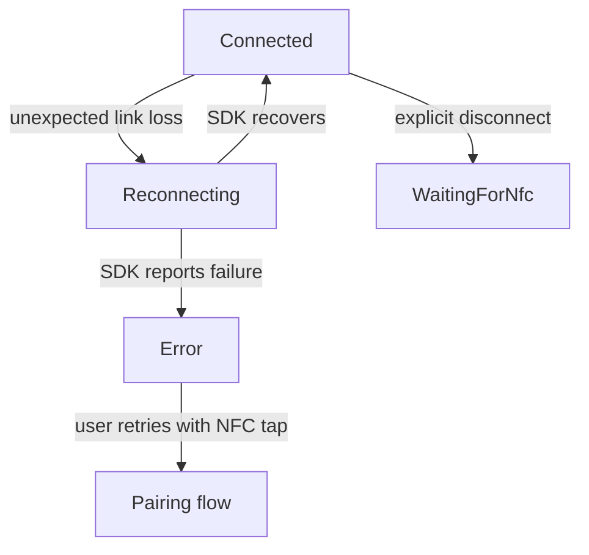

# Best practices for production hosts

## Connection ownership and recovery

Create one `SnapHalo` per scanner owner. On Android, create exactly one `SnapHaloAndroid` per Activity after `super.onCreate`; recreate that adapter when the Activity is recreated. Keep the client with its owner, such as a ViewModel, if it must survive rotation. Close the adapter with the Activity and close/dispose the client only when its owner is finished. A disposed client cannot be reused.

The SDK already enters `Reconnecting` after unexpected link loss and retries internally, with a documented one-second delay after failed attempts. Do not run a parallel BLE scan or app retry loop during `Reconnecting`; it can compete with the SDK and waste battery. After `Error`, surface `errorMessage` and ask for a fresh NFC tap. If a product needs repeated user-visible retry prompts, back those prompts off exponentially in the app layer rather than repeatedly constructing clients or calling an internal connection method. Explicit disconnect stops SDK reconnection; on Android cancel pending NFC work before `disconnect()`.

## Threading and event flow

All public `SnapHaloAndroid` methods require the main thread. iOS `startPairing(onError:)` is also a main-thread user-flow call, and Swift `observeEvents` delivers on the main thread. Android `events` is a no-replay `SharedFlow`; collect it before connection and cancel the collector with its lifecycle. Dispatch UI state updates to the main thread if collecting from a background scope. 

Use suspending Kotlin calls or Swift `async/await` for queries and commands. Do not block the UI thread waiting for responses. Preserve coroutine cancellation; catch `TimeoutCancellationException` before `CancellationException` when a query timeout needs a distinct message. Read reported device state after settings writes when correctness matters, because setters only confirm BLE writes.

## MTU and throughput

The SDK manages GATT discovery, Android MTU negotiation, and write ordering internally. Its authentication path checks that the response fits the negotiated MTU and reports `Error` if it does not. The public API has no MTU, connection-interval, raw packet, or write-queue control. Treat throughput tuning as a device/SDK integration issue rather than adding host-side packet writes.

For high-volume barcodes, process `OnBarcodeScanned` quickly and move durable storage or network work to another queue. Each barcode has one public event, but slow subscribers can lose old notifications from the shared buffer. Stop software-trigger scanning when the UI no longer needs it; the [samples](../Samples/Kotlin/README.md) demonstrate explicit Start/Stop controls and Single mode behavior.

## Battery and thermal etiquette

The SDK starts battery polling on connection and repeats it every minute; `battery.telemetry` is its cached value. Avoid adding an app polling loop unless a user action needs a fresh `getTelemetry()` result. Release a continuous software trigger with `barcode.stopScan()` when the screen closes or the workflow pauses. Close the SDK client when its owner ends so polling and reconnection stop. The supplied samples do not require a host wake lock; add one only for a separately justified foreground workflow.

## Security and bond loss

Modern NFC LE OOB records may carry Cr/Nr proof credentials. The SDK keeps those bytes internally and does not expose a host storage API. Do not log tag records, credentials, or raw authentication packets. Application-layer tap proof is separate from OS Bluetooth bonding. `authLevel` and connection-event `authLevel` give read-only status; customer signer and administrator key configuration are not public.

If the user resets the scanner or clears the phone's Bluetooth bond, end the old session, follow the platform's normal Bluetooth settings flow, and request a fresh NFC tap. Capture `OnConnectionStatus.errorMessage` and `OnSecurityWarning.message` for diagnosis without persisting secrets. See [pairing](02-Pairing-and-Connection.md) and [troubleshooting](06-Troubleshooting-and-Error-Codes.md).
