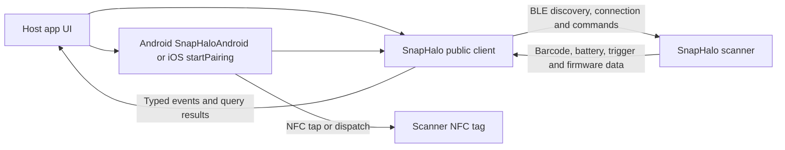
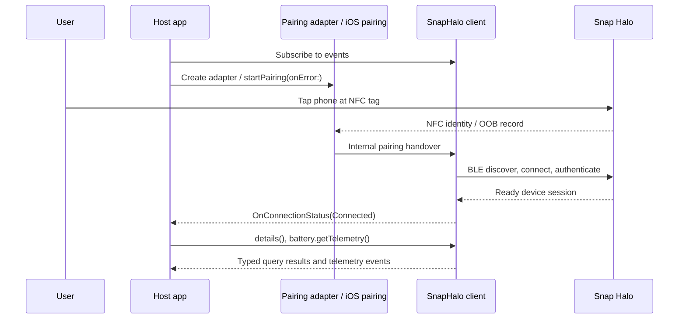

# SnapIPC SDK 1.0.0

The `SnapHalo` client in the SnapIPC SDK connects a host app to an IPCMobile SnapHalo barcode scanner. It owns NFC tap to pair, BLE discovery and connection, device commands, barcode, battery, buzzer, lights, physical trigger, firmware, and connection events. 

Android provides an Activity-bound `SnapHaloAndroid` adapter for NFC and permissions; iOS provides `SnapHalo.startPairing(onError:)`. The shipped artifacts are an Android AAR and iOS XCFramework. The iOS framework includes the public `SnapHaloFirmwareUploader` API.

## System architecture

The SDK sends commands over BLE and an internal proprietary OOB credential handshake. The Snap Halo also can have a company key which is detailed in the Security Document. For reference to the Security document please e-mail support@ipcmobiile.com

`Connected` is the SDK's command-ready state after service discovery and any required authentication. See [Pairing and connection](02-Pairing-and-Connection.md) for the actual state names and ownership rules.

## Sample applications

| Sample | Platform / language | Demonstrates |
| --- | --- | --- |
| [Android native](../Samples/Kotlin/README.md) | Android / Kotlin / Compose | NFC dispatch and reader mode, BLE connection, barcode commands/events, battery, firmware events, scan modes and settings |
| [iOS native](../Samples/Swift/README.md) | iOS / Swift / SwiftUI | NFC pairing sheet, BLE connection, event observation, barcode controls, battery, firmware upload |
| [React Native](../Samples/ReactNative/README.md) | Android + iOS / TypeScript with Kotlin and Swift bridges | Shared scanner UI, Android permission retry and NFC tap flow, native events, scan controls and settings |

Hardware pairing requires a physical phone and scanner. No minimum scanner firmware version is supplied with this distribution; validate the reported firmware against the devices you ship.

## Navigation

| Goal | Guide |
| --- | --- |
| Run a sample or integrate the binary SDK | [Quickstart](01-Quickstart.md) |
| Understand NFC tap, BLE readiness, and reconnection | [Pairing and connection](02-Pairing-and-Connection.md) |
| Send commands and consume telemetry | [Core SDK usage](03-Core-SDK-Usage.md) |
| Implement Android or iOS firmware upload | [OTA firmware updates](04-OTA-Updates.md) |
| Design a durable host integration | [Best practices](05-Best-Practices.md) |
| Recover from failures | [Troubleshooting and error surfaces](06-Troubleshooting-and-Error-Codes.md) |
| Browse all guides and samples | [Sidebar](./_Sidebar.md) |
